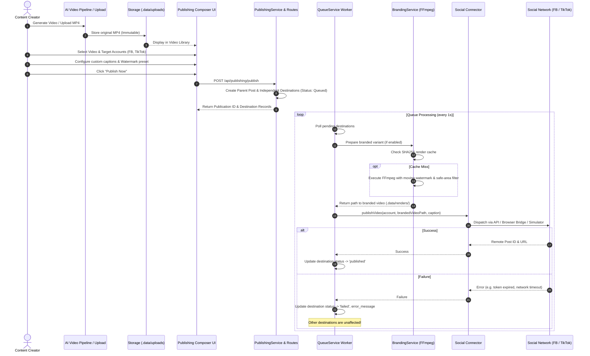
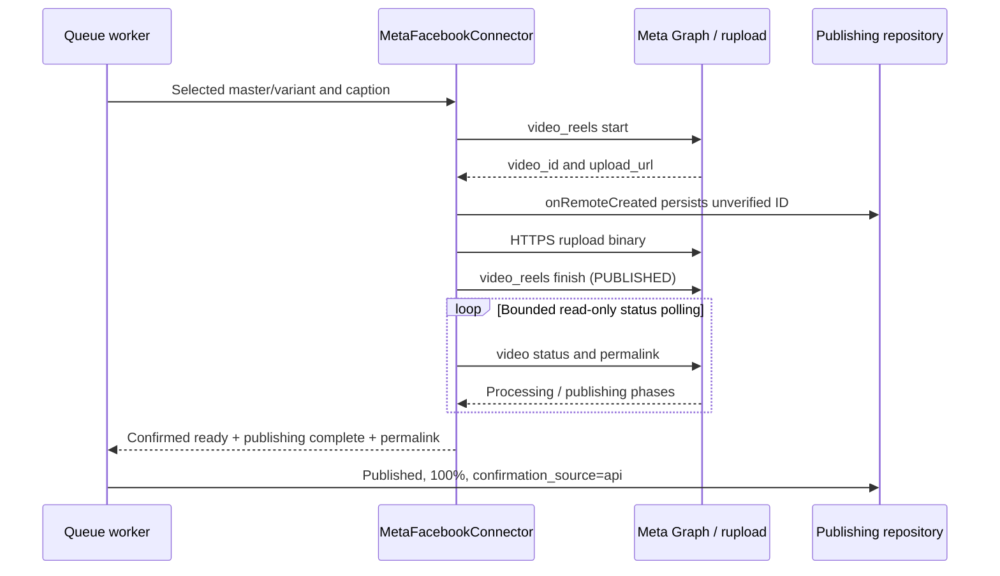

# Social Command Center — Project & Architecture Map

> **Comprehensive architectural reference, component map, and task-to-file navigation guide for the Social Command Center.**

V1.12 adds `services/operator-workspace.service.ts` and `routes/operator-workspace.routes.ts` for sanitized Page briefs and idempotent external draft imports, reusing the calendar and its approval rules. `services/reply-drafts.service.ts` stores reply intents/receipts in the existing workspace audit; `repositories/groups-handoff.repo.ts` captures immutable manual Group context without a schema migration. Current acceptance and owner-runtime boundaries: [V1.12 report](qa/V1_12_SOCIAL_AUTOPILOT.md).

---

## 1. High-Level System Architecture

---

## 2. Directory Layout & Layer Responsibilities

### Frontend (`client/src/`)
| Directory / File | Responsibility |
| :--- | :--- |
| [`client/src/App.tsx`](file:///d:/Mamduh/Personal/social-account-managemnet/client/src/App.tsx) | Navigation shell, active view switching, header, platform status strip. |
| [`client/src/theme/tokens.ts`](file:///d:/Mamduh/Personal/social-account-managemnet/client/src/theme/tokens.ts) | Semantic design tokens (surfaces, text colors, platform badges, safe area margins). |
| [`client/src/types/index.ts`](file:///d:/Mamduh/Personal/social-account-managemnet/client/src/types/index.ts) | Frontend TypeScript interface definitions matching backend contracts. |
| [`client/src/api/client.ts`](file:///d:/Mamduh/Personal/social-account-managemnet/client/src/api/client.ts) | Fully typed API client for accounts, publishing, branding, inbox, and analytics. |
| [`client/src/hooks/`](file:///d:/Mamduh/Personal/social-account-managemnet/client/src/hooks/) | State management hooks (`useAccounts.ts`, `usePublishing.ts`, `useInbox.ts`). |
| [`client/src/components/common/`](file:///d:/Mamduh/Personal/social-account-managemnet/client/src/components/common/) | Reusable presentation primitives: `Button`, `Badge`, `Card`, `Modal`, `MetricCard`, `EmptyState`. |
| [`client/src/components/accounts/`](file:///d:/Mamduh/Personal/social-account-managemnet/client/src/components/accounts/) | `AccountCard.tsx`, `CategoryCard.tsx`, `ConnectAccountModal.tsx`, `CreateCategoryModal.tsx`. |
| [`client/src/components/publishing/`](file:///d:/Mamduh/Personal/social-account-managemnet/client/src/components/publishing/) | `DestinationConfigCard.tsx`, `QueueTable.tsx`, `VideoLibraryGrid.tsx`. |
| [`client/src/components/branding/`](file:///d:/Mamduh/Personal/social-account-managemnet/client/src/components/branding/) | `WatermarkCanvas.tsx` (60 FPS HTML5 preview), `WatermarkControls.tsx`. |
| [`client/src/components/inbox/`](file:///d:/Mamduh/Personal/social-account-managemnet/client/src/components/inbox/) | `CommentItem.tsx`, `CommentFilters.tsx`. |
| [`client/src/components/analytics/`](file:///d:/Mamduh/Personal/social-account-managemnet/client/src/components/analytics/) | `RecordObservationModal.tsx` (verified observation modal with provenance badge). |
| [`client/src/views/`](file:///d:/Mamduh/Personal/social-account-managemnet/client/src/views/) | Composed view screens: `DashboardView`, `AccountsView`, `PublishingView`, `BrandingStudioView`, `InboxView`, `ActivityView`, `AnalyticsView`, `SettingsView`. |

### Backend (`server/src/`)
| Directory / File | Responsibility |
| :--- | :--- |
| [`server/src/index.ts`](file:///d:/Mamduh/Personal/social-account-managemnet/server/src/index.ts) | App initialization, database migration/bootstrapping, route mounting, background worker & sync scheduler launch. |
| [`server/src/domain/`](file:///d:/Mamduh/Personal/social-account-managemnet/server/src/domain/) | Pure business rules and math: `publishing.ts`, `branding.ts`, `account-identity.ts`, `types.ts`. Free of I/O or DB. |
| [`server/src/repositories/`](file:///d:/Mamduh/Personal/social-account-managemnet/server/src/repositories/) | Data access layer using `better-sqlite3`: `accounts.repo.ts`, `publishing.repo.ts`, `inbox.repo.ts`, `activity.repo.ts`, `analytics.repo.ts`. |
| [`server/src/services/`](file:///d:/Mamduh/Personal/social-account-managemnet/server/src/services/) | Workflow orchestrators: `publishing.service.ts`, `queue.service.ts`, `branding.service.ts`, `sync.service.ts`, `pipeline.service.ts`. |
| [`server/src/connectors/`](file:///d:/Mamduh/Personal/social-account-managemnet/server/src/connectors/) | Platform adapters implementing `AccountConnector` interface: `simulator.ts`, `meta-facebook.ts`, `tiktok.ts`, `browser-bridge.ts`, `registry.ts`. |
| [`server/src/routes/`](file:///d:/Mamduh/Personal/social-account-managemnet/server/src/routes/) | Express 5 HTTP endpoints: `accounts.routes.ts`, `publishing.routes.ts`, `branding.routes.ts`, `inbox.routes.ts`, `activity.routes.ts`, `analytics.routes.ts`, `bridge.routes.ts`, `connections.routes.ts`. |

---

## 3. Video-to-Publication Flow

---

## 4. V1.6 capabilities and verification boundaries (20 October 2026)

| Workflow | Current behavior | Evidence |
| :--- | :--- | :--- |
| Real account registry | Credential-free Facebook Pages and TikTok Personal/Business registration, edit, categories, avatar URL/upload, notes, preferences, archive/restore | Automated and browser acceptance |
| Simulator | Six preserved demo records; hidden by default; explicit demo publishing toggle | Local simulator only |
| Meta OAuth | Consent, actual granted scopes, Page discovery/tasks, explicit selection onto the existing internal ID, encrypted Page token, strict alias/canonical ID reconciliation | LIVE PASS on the owner's Page, including reauthorization |
| Meta Reels adapter | Start, persist remote ID, rupload binary, finish, then verify ready/complete status and permalink; worker completes automatically with API provenance | LIVE PASS: Reel `2657809668013982`; no manual confirmation |
| Local scheduled publishing | Bangkok wall-clock -> UTC ISO, future validation, SQLite date comparison, two-second due dispatch; no second Meta schedule | Automated lifecycle PASS; actual schedule saved/held; public scheduled publication PENDING owner verification |
| TikTok Web Login | Profile identity/scope binding and refresh-token rotation; account type unchanged | Implemented & tested in isolated suite; real app/HTTPS authorization PENDING |
| TikTok Display API Real Analytics | `POST /v2/video/query/` for existing videos, paginated `video.list`, numeric zero preservation, scope fallback | Implemented & tested in isolated suite; live synchronization PENDING account authorization |
| TikTok Content Posting API Direct Post / Upload | Anti-utility-tool developer policy prevents internal management tools; watermark restrictions on API uploads | BLOCKED BY POLICY / AUDIT REQUIRED |
| TikTok for Business Accounts API | Separate business API officially supports both Personal and Business Accounts for owned publishing, insights, and comment moderation (`comment.list`, `comment.list.manage`) | APPLICATION & APPROVAL REQUIRED; Native Platform Handoff retained |
| Native browser handoff | Original/branded MP4, caption, native links, exact-account manual URL confirmation; distinct from API verification | Earlier live manual Facebook/TikTok acceptance and isolated workflow tests |
| Inbox / analytics | Scope-gated provider reads, 15-minute background sync, SSE, append-only observations, no fabricated real metrics | Fixtures and historical browser/manual baselines; do not infer universal live API coverage |

`GET /api/connectors/capabilities` describes the default unavailable state and points to per-account capabilities on `GET /api/accounts`. The registry gates execution with the same account grants used for display. A browser profile directory never proves API authorization. See `qa/OFFICIAL_API_AUTHORIZATION_ACCEPTANCE.md` for dated evidence and the protected job. A saved schedule or fixture PASS is not public publication proof.

---

## 5. Task-to-File Reference Table

When working on a specific task, use this reference table to find the primary files, state contracts, and verification tests without having to search the entire project:

| Task | Primary Files | Related Contract / State | Relevant Tests |
| :--- | :--- | :--- | :--- |
| **Change Navigation or Top Header** | [`client/src/App.tsx`](file:///d:/Mamduh/Personal/social-account-managemnet/client/src/App.tsx) | `activeView`, `VIEW_KEYS` in [`client/src/types/index.ts`](file:///d:/Mamduh/Personal/social-account-managemnet/client/src/types/index.ts) | `test/e2e/autonomous_acceptance.ts` (Phase 1) |
| **Restyle Account Cards or Category Badges** | [`client/src/components/accounts/AccountCard.tsx`](file:///d:/Mamduh/Personal/social-account-managemnet/client/src/components/accounts/AccountCard.tsx) [`client/src/components/accounts/CategoryCard.tsx`](file:///d:/Mamduh/Personal/social-account-managemnet/client/src/components/accounts/CategoryCard.tsx) | `SocialAccount`, `ContentCategory` in [`client/src/types/index.ts`](file:///d:/Mamduh/Personal/social-account-managemnet/client/src/types/index.ts) | `test/e2e/autonomous_acceptance.ts` (Phase 3 Workflow A) |
| **Redesign Publishing Composer or Video Selector** | [`client/src/views/PublishingView.tsx`](file:///d:/Mamduh/Personal/social-account-managemnet/client/src/views/PublishingView.tsx) [`client/src/components/publishing/DestinationConfigCard.tsx`](file:///d:/Mamduh/Personal/social-account-managemnet/client/src/components/publishing/DestinationConfigCard.tsx) | `CreatePublishingPayload` in [`client/src/types/index.ts`](file:///d:/Mamduh/Personal/social-account-managemnet/client/src/types/index.ts) | `test/e2e/autonomous_acceptance.ts` (Phase 3 Workflow B) |
| **Modify Publishing Queue Table or Retry Actions** | [`client/src/components/publishing/QueueTable.tsx`](file:///d:/Mamduh/Personal/social-account-managemnet/client/src/components/publishing/QueueTable.tsx) [`client/src/hooks/usePublishing.ts`](file:///d:/Mamduh/Personal/social-account-managemnet/client/src/hooks/usePublishing.ts) | `PublishingDestination`, `DestinationStatus` | `test/social_command_center.test.ts` (Tests 3, 4, 5) |
| **Change Watermark Preview Canvas or Controls** | [`client/src/components/branding/WatermarkCanvas.tsx`](file:///d:/Mamduh/Personal/social-account-managemnet/client/src/components/branding/WatermarkCanvas.tsx) [`client/src/components/branding/WatermarkControls.tsx`](file:///d:/Mamduh/Personal/social-account-managemnet/client/src/components/branding/WatermarkControls.tsx) | `BrandingPreset`, `calculateWatermarkPosition` in [`server/src/domain/branding.ts`](file:///d:/Mamduh/Personal/social-account-managemnet/server/src/domain/branding.ts) | `test/domain_and_repositories.test.ts` (Tests 4, 5) |
| **Change Inbox Presentation or Reply Dialogs** | [`client/src/views/InboxView.tsx`](file:///d:/Mamduh/Personal/social-account-managemnet/client/src/views/InboxView.tsx) [`client/src/components/inbox/CommentItem.tsx`](file:///d:/Mamduh/Personal/social-account-managemnet/client/src/components/inbox/CommentItem.tsx) | `InboxComment` in [`client/src/types/index.ts`](file:///d:/Mamduh/Personal/social-account-managemnet/client/src/types/index.ts) | `test/e2e/autonomous_acceptance.ts` (Phase 3 Workflow D) |
| **Add a Connector Capability** | `server/src/connectors/registry.ts`, `server/src/connectors/types.ts`, platform adapter | `ConnectorCapabilities` and confirmed `PublishResult` | `test/meta_reels_publishing.test.ts`, `test/official_api_authorization.test.ts` |
| **Modify Queue Dispatch or Recovery Logic** | [`server/src/services/queue.service.ts`](file:///d:/Mamduh/Personal/social-account-managemnet/server/src/services/queue.service.ts) [`server/src/domain/publishing.ts`](file:///d:/Mamduh/Personal/social-account-managemnet/server/src/domain/publishing.ts) | `PublishingRepo` in [`server/src/repositories/publishing.repo.ts`](file:///d:/Mamduh/Personal/social-account-managemnet/server/src/repositories/publishing.repo.ts) | `test/social_command_center.test.ts` (Test 9), `test/domain_and_repositories.test.ts` |
| **Change Ingestion Folder Configuration** | [`server/src/services/pipeline.service.ts`](file:///d:/Mamduh/Personal/social-account-managemnet/server/src/services/pipeline.service.ts) | `INGESTION_DIR` in `.env` / configuration | `test/e2e/autonomous_acceptance.ts` (Phase 1 Screen 8) |
| **Update Theme Colors, Surfaces, or Borders** | [`client/src/theme/tokens.ts`](file:///d:/Mamduh/Personal/social-account-managemnet/client/src/theme/tokens.ts) [`client/src/index.css`](file:///d:/Mamduh/Personal/social-account-managemnet/client/src/index.css) | `tokens` object (Surfaces, Text, Status, Safe Areas) | `npm run build:client` |

## 6. V1.2 onboarding implementation map

| Task | Entry points |
| :--- | :--- |
| Register/edit/archive/search/paginate | `client/src/views/AccountsView.tsx`; `ConnectAccountModal.tsx`, `AccountCard.tsx`; `server/src/routes/accounts.routes.ts` |
| Identity normalization, duplicate aliases, safe native URLs | `server/src/domain/account-identity.ts`; `services/accounts.service.ts`; `repositories/account-connections.repo.ts` |
| Per-account OAuth setup, consent, callback, selection, refresh | `components/accounts/ConnectionModal.tsx`; `routes/connections.routes.ts`; `services/connections.service.ts` |
| Protect tokens and OAuth candidate payloads | `services/token-protection.ts`; `oauth_sessions` and `account_identities` in `db/schema.ts` |
| Per-account branding and preferences | Existing Branding Studio / branding routes; defaults in the public account projection; composer in `hooks/usePublishing.ts` |
| Native MP4 handoff and manual publication receipt | `routes/bridge.routes.ts`; `components/publishing/HandoffModal.tsx`; `QueueTable.tsx`; `services/publishing.service.ts` |
| Prevent simulator fallback, handle expiry, hold restart recovery | `connectors/registry.ts`; `services/queue.service.ts`; `repositories/publishing.repo.ts` |
| Avatar upload | `services/avatars.service.ts`; `/api/accounts/avatar`; local `.data/uploads/avatars` |
| Automated / browser / upstream regression evidence | `test/real_accounts.test.ts`; `test/e2e/real_account_onboarding.ts`; `test/e2e/run_pipeline_regression.ts`; `docs/qa/REAL_ACCOUNT_ONBOARDING_ACCEPTANCE.md` |

The registry is independent of the video library and render cache. Migrations add columns/tables without rebuilding account or publication tables. Identity aliases reserve prior handles to prevent accidental duplicate registration after renaming. Existing ambiguous historical records are preserved, never automatically merged. Archive is reversible and does not release identity claims.

## 7. OAuth, Reels and scheduling implementation

### Authorization and credentials

`connections.routes.ts` owns setup/start/callback/select/refresh/disconnect endpoints under `/api/connections`. The accepted Facebook callback is `http://localhost:3001/api/connections/callback/facebook`, with exact origin/path checks and no trailing slash. Secrets stay server-side in environment/ignored `.env`; `token-protection.ts` uses AES-256-GCM with a base64 32-byte `SCC_TOKEN_ENCRYPTION_KEY`.

`connections.service.ts` creates hashed state/browser bindings, account revision and a ten-minute expiry. The initial pending payload seals the requested scopes and redirect; `account-connections.repo.ts` atomically changes `started` to `exchanging`, then stores sealed candidates under `selecting`. Explicit identity selection saves encrypted tokens on the same account and consumes the session. Concurrent account edits/disconnect/archive invalidate completion. A bad state/replayed callback must not consume a valid selection.

Default Facebook discovery/read scopes are `pages_show_list`, `pages_read_engagement`, `pages_read_user_content`; selected publishing/moderation add `pages_manage_posts` / `pages_manage_engagement`. Actual permissions come from `/me/permissions`, with task filtering when Meta provides Page tasks. Operation requests that were declined fail explicitly. The live missing-`expires_in` case is verified through `/debug_token`, not interpreted as automatic rejection or unlimited validity. Explicit zero expiry uses a bounded 24-hour local window, limited by data-access expiry. `oauth-diagnostics.ts` emits allowlisted stages/references/numeric codes, never codes, state, cookies or token bodies.

The owner Page's original registered/public ID `61563944843401` and Graph Page ID `409347032254077` are aliases of one persisted internal account. Reauthorization accepts its own identity claim; another account's claim fails. Initial canonical resolution needs a trusted alias or a Meta response, never display-name similarity. These IDs are acceptance data, not constants in the generic connector.

### Verified API publication

`meta-facebook.ts` rejects unsuccessful HTTP/phase responses and unexpected upload/permalink hosts. It never falls back to a second standard-video upload after a Reels error. The remote ID is durable before subsequent network calls; failed/uncertain real submissions are not automatically retried. `publishing.service.ts` blocks blind explicit retry when a remote upload exists. A ready/complete result updates destination and parent automatically; a manual bridge result remains `awaiting_confirmation` until an explicit exact-account URL receipt.

### Local scheduler and UI

| Layer | Responsibility |
| --- | --- |
| `client/src/hooks/usePublishing.ts` | Treat the displayed datetime-local as Bangkok UTC+07:00, validate future time, send UTC ISO and expose errors |
| `client/src/views/PublishingView.tsx` | Capability-honest API/manual/demo targets, master/variant preview, Schedule Post form |
| `client/src/components/publishing/QueueTable.tsx` | Pending Dispatch + Scheduled, Bangkok target time, cancellation before dispatch; separate API/manual provenance |
| `server/src/services/publishing.service.ts` | Validate explicit timezone/future timestamp; persist one parent and independent scheduled destinations |
| `server/src/repositories/publishing.repo.ts` | `julianday` due comparisons, future-job exclusion, durable remote IDs and confirmation source |
| `server/src/services/queue.service.ts` | Two-second polling; due -> preparing -> API dispatch; do not forward expired `scheduledAt` to Meta; exclude terminal/restart-held/future work |
| `server/src/domain/publishing.ts` | Retry failed/cancelled only, preserve published results; explicit restart recovery is handled separately |

The scheduler needs the local process and PC awake. It does not delegate timing to a cloud service. Future schedules survive boot; interrupted active jobs retain a review hold. Real failures do not auto-replay; no content-wide deduplication is implied for a separately created post.

The protected Tesla job `dest-mvg66513-ttjf` / `post-74051364-849a-4195-b132-d76c19fa10ca` (target **20 October 2026, 12:14 PM Asia/Bangkok**) was automatically dispatched to Meta Graph API by the background worker, published as remote Reel `2100761720535236` with confirmed API provenance; public publication remains the owner's verification gate.

### Regression entry points

`facebook_reauthorization.test.ts` covers expiry metadata, identity/alias/duplicate handling, credential preservation and safe errors. `meta_reels_publishing.test.ts` covers phase failures, no fallback, polling and master invariance. `reels_queue_acceptance.test.ts` covers API completion, manual/restart replay exclusions, durable remote ID, uncertain retry blocking and an isolated one-hour schedule advanced to due time. `tiktok_official_integration.test.ts` covers TikTok OAuth state CSRF, token encryption, Display API real metrics query, confirmed 0 vs missing data, paginated video listing, rate limits, scope fallback, Content Posting API policy rejection, and Accounts API segregation. Together with the other suites, the current total is 76 tests across nine suites; all use isolated data.

TikTok Content Posting API Direct Post is blocked by policy for internal utility tools; TikTok for Business Accounts API officially supports both Personal and Business Accounts for owned-account publishing and comment moderation upon partner approval. Live official authorization and public publication remain separate next-milestone work.

## V1.10 general posts and content workspace

| Area | Files and responsibilities |
| --- | --- |
| General publishing composer | client/src/components/publishing/GeneralPostComposer.tsx, hooks/useGeneralPosts.ts, types/general-posts.ts; existing PublishingView selects general posts or the unchanged Reel workflow |
| Draft rules and approvals | server/src/domain/general-posts.ts, services/general-posts.service.ts, repositories/general-posts.repo.ts; exact revision/hash/destination/schedule binding, atomic batch approval, one-time queue transition |
| Media | services/image-media.service.ts; actual JPEG/PNG decode, size/dimension bounds, immutable originals, SHA256 and managed-path verification; image records live in the repository |
| General endpoints | routes/general-publishing.routes.ts; drafts, images, capabilities, audit and read-only remote reconciliation |
| Queue and connectors | existing queue.service.ts, publishing.repo.ts, registry.ts and meta-facebook.ts; nullable video parent, explicit content_type, per-destination ordered attachment rows, durable photo/feed intent and remote IDs; FFmpeg remains Reel-only |
| Owner voice and assistant | domain/content-assistant.ts; db/content-workspace{,-schema}.ts; repositories/content-workspace.repo.ts; services/content-assistant.service.ts; routes/content-assistant.routes.ts; client views/ContentAssistantView.tsx and api/content-workspace.ts |
| Groups | services/groups-workspace.service.ts, routes/groups-workspace.routes.ts, client/views/GroupsWorkspaceView.tsx; manual/unverified registry, rules, packages and receipts; no Page API dispatch |
| Migration | db/general-posts-schema.ts; scripts/prepare-general-posts-migration.ts; source opened read-only, migration on a new copy only, exact old publication/destination values and foreign keys checked |
| Isolated review | scripts/run-v110-review.ts, test/e2e/v110_review_server.ts; separate database/client bundle, external fetch blocked, fixture workers paused; owner services remain independent |
| Verification | test/general_posts.test.ts, meta_general_posts.test.ts, content_workspace.test.ts, test/e2e/v110_general_posts.ts, content_workspace_acceptance.ts; latest results in docs/qa/V1_10_GENERAL_POSTS_CONTENT_ASSISTANT.md |

Assistant generation never executes publishing APIs. Approved assistant text transfers into a new unapproved publishing draft with its source revision/context hash recorded in the audit. General drafts enqueue into publishing_posts/publishing_destinations only after exact-revision approval; attachment upload IDs and uncertain intent are stored per destination. Old video rows default to content_type=reel. Existing databases require explicit offline migration; startup does not rebuild their publishing table.

## V1.10 runtime recovery and real text provider

- server/src/services/assistant-provider.ts selects only explicit real Gemini Free-tier configuration or separately labeled fixtures/unavailable mode. It validates the source configuration fingerprint/attestation/model, reserves a durable bounded request before native text-only inference, strips unrelated facts from caption input, sanitizes failures and returns secret-free model/request/usage metadata. The existing content-assistant service saves it in draft provenance; it has no publishing execution path.
- scripts/run-v110-review.ts --provider-config selects the ignored local configuration; test/e2e/v110_review_server.ts permits that exact text endpoint while blocking social calls and pausing only review workers. test/e2e/v110_real_generation.ts records genuine synthetic calls and browser/revision/safety checks separately from test/assistant_provider.test.ts transport mocks.
- server/src/domain/runtime-recovery.ts contains pure queue restoration guards; scripts/recover-owner-runtime.ts freezes pre-V1.10 source, rehearses it on a copy and starts only a free owner port after live recheck. Owner source/data are pinned separately from dirty V1.10 review code/data. test/runtime_recovery.test.ts covers due/uncertain/in-flight refusal and protected holds.
- Current operational source/process/schema distinctions and remaining rollout gates: docs/qa/V1_10_RUNTIME_RECOVERY_REAL_GENERATION.md.

## V1.10 controlled owner release and startup

| Responsibility | Implementation |
| --- | --- |
| Atomic schema maintenance | server/src/db/v110-migration.ts; scripts/prepare-general-posts-migration.ts remains copy-only; scripts/apply-v110-migration.ts applies only after verified backup and fresh maintenance gates |
| Frozen release provenance | scripts/package-owner-release.ts; canonical client source fingerprint, Git checkpoint extraction and source/bundle checksums |
| Current-user owner lifecycle | scripts/owner-runtime.ts and scripts/lib/owner-runtime-core.ts; fixed private configuration, exclusive lifecycle lock, PID/start-time/entrypoint ownership, readiness before proxy, hidden Startup-folder entry |
| Managed boot and graceful stop | server/src/index.ts; server/src/routes/runtime.routes.ts; publishingStartupHold in domain/runtime-recovery.ts; authenticated idle-only shutdown and no-reset publishing hold |
| Regression and operations | test/v110_rollout.test.ts; tsconfig.operations.json; docs/qa/V1_10_PRODUCTION_ROLLOUT.md includes baseline, rollback, evidence and remaining platform acceptance |

The owner keeps its original database, credentials, media and certificate; the review instance remains separate. Historical recovery records identify 12ae5d8, while current deployed revision/status are in the production rollout report. The current-user startup entry runs only owner backend/proxy, never the review app. General Page public publishing still needs separate Facebook acceptance.

Verified owner deployment: cccf9390542199fb18ae442753eba87088c9b255 on loopback 3001/3443, original database migrated atomically after verified backup, current-user startup enabled. Automatic Facebook/TikTok boot synchronization and nine owner-browser checks passed; no live general-post dispatch was exercised. The configured draft provider retains its existing six-request cap (five used); no synthetic voice profiles were imported. See the production rollout report for exact evidence and limits.
