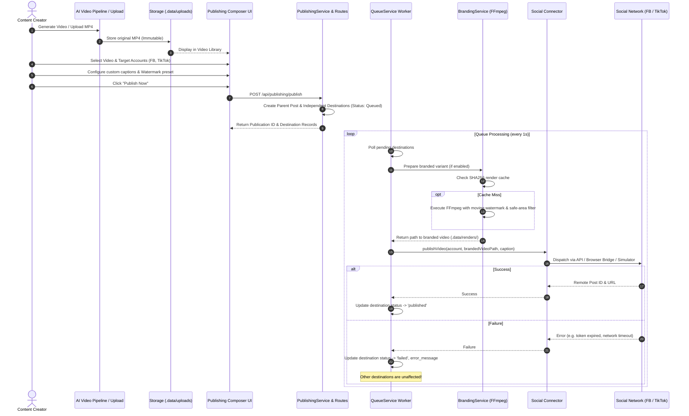

# Social Command Center — Project & Architecture Map

> **Comprehensive architectural reference, component map, and task-to-file navigation guide for the Social Command Center.**

---

## 1. High-Level System Architecture

---

## 2. Directory Layout & Layer Responsibilities

### Frontend (`client/src/`)
| Directory / File | Responsibility |
| :--- | :--- |
| [`client/src/App.tsx`](file:///d:/Mamduh/Personal/social-account-managemnet/client/src/App.tsx) | Navigation shell, active view switching, header, platform status strip. |
| [`client/src/theme/tokens.ts`](file:///d:/Mamduh/Personal/social-account-managemnet/client/src/theme/tokens.ts) | Semantic design tokens (surfaces, text colors, platform badges, safe area margins). |
| [`client/src/types/index.ts`](file:///d:/Mamduh/Personal/social-account-managemnet/client/src/types/index.ts) | Frontend TypeScript interface definitions matching backend contracts. |
| [`client/src/api/client.ts`](file:///d:/Mamduh/Personal/social-account-managemnet/client/src/api/client.ts) | Fully typed API client for accounts, publishing, branding, inbox, and analytics. |
| [`client/src/hooks/`](file:///d:/Mamduh/Personal/social-account-managemnet/client/src/hooks/) | State management hooks (`useAccounts.ts`, `usePublishing.ts`, `useInbox.ts`). |
| [`client/src/components/common/`](file:///d:/Mamduh/Personal/social-account-managemnet/client/src/components/common/) | Reusable presentation primitives: `Button`, `Badge`, `Card`, `Modal`, `MetricCard`, `EmptyState`. |
| [`client/src/components/accounts/`](file:///d:/Mamduh/Personal/social-account-managemnet/client/src/components/accounts/) | `AccountCard.tsx`, `CategoryCard.tsx`, `ConnectAccountModal.tsx`, `CreateCategoryModal.tsx`. |
| [`client/src/components/publishing/`](file:///d:/Mamduh/Personal/social-account-managemnet/client/src/components/publishing/) | `DestinationConfigCard.tsx`, `QueueTable.tsx`, `VideoLibraryGrid.tsx`. |
| [`client/src/components/branding/`](file:///d:/Mamduh/Personal/social-account-managemnet/client/src/components/branding/) | `WatermarkCanvas.tsx` (60 FPS HTML5 preview), `WatermarkControls.tsx`. |
| [`client/src/components/inbox/`](file:///d:/Mamduh/Personal/social-account-managemnet/client/src/components/inbox/) | `CommentItem.tsx`, `CommentFilters.tsx`. |
| [`client/src/views/`](file:///d:/Mamduh/Personal/social-account-managemnet/client/src/views/) | Composed view screens: `DashboardView`, `AccountsView`, `PublishingView`, `BrandingStudioView`, `InboxView`, `ActivityView`, `AnalyticsView`, `SettingsView`. |

### Backend (`server/src/`)
| Directory / File | Responsibility |
| :--- | :--- |
| [`server/src/index.ts`](file:///d:/Mamduh/Personal/social-account-managemnet/server/src/index.ts) | App initialization, database migration/bootstrapping, route mounting, background worker launch. |
| [`server/src/domain/`](file:///d:/Mamduh/Personal/social-account-managemnet/server/src/domain/) | Pure business rules and math: `publishing.ts`, `branding.ts`, `types.ts`. Free of I/O or DB. |
| [`server/src/repositories/`](file:///d:/Mamduh/Personal/social-account-managemnet/server/src/repositories/) | Data access layer using `better-sqlite3`: `accounts.repo.ts`, `publishing.repo.ts`, `inbox.repo.ts`, `activity.repo.ts`, `analytics.repo.ts`. |
| [`server/src/services/`](file:///d:/Mamduh/Personal/social-account-managemnet/server/src/services/) | Workflow orchestrators: `publishing.service.ts`, `queue.service.ts`, `branding.service.ts`, `pipeline.service.ts`. |
| [`server/src/connectors/`](file:///d:/Mamduh/Personal/social-account-managemnet/server/src/connectors/) | Platform adapters implementing `SocialConnector` interface: `simulator.connector.ts`, `meta.connector.ts`, `tiktok.connector.ts`, `browser-bridge.connector.ts`. |
| [`server/src/routes/`](file:///d:/Mamduh/Personal/social-account-managemnet/server/src/routes/) | Express 5 HTTP endpoints: `accounts.routes.ts`, `publishing.routes.ts`, `branding.routes.ts`, `inbox.routes.ts`, `activity.routes.ts`, `analytics.routes.ts`, `bridge.routes.ts`. |

---

## 3. Video-to-Publication Flow

---

## 4. V1.2 capabilities and verification boundaries

| Workflow | Current behavior | Evidence |
| :--- | :--- | :--- |
| Real account registry | Credential-free Facebook Pages and TikTok Personal/Business registration, edit, categories, avatar URL/upload, notes, preferences, archive/restore | Automated and browser acceptance |
| Simulator | Six preserved demo records; hidden by default; explicit demo publishing toggle | Local simulator only |
| Meta OAuth | Consent, scoped Page discovery, task filtering, explicit selection onto existing internal ID, encrypted Page token | Mocked official responses; live authorization PENDING |
| Meta video adapter | Available only with verified identity, valid encrypted token and actual publishing scopes; submission stays unconfirmed until reviewed | Live submission PENDING |
| TikTok Web Login | Profile identity/scope binding and refresh-token rotation; account type unchanged | Mocked official responses; real app/HTTPS authorization PENDING |
| TikTok Direct Post / Accounts API | Disabled/pending additional product access and implementation; no claim of comments or analytics access | PENDING |
| Native browser handoff | Original/branded MP4, per-account caption, native links, manual URL confirmation; no scraping or stealth automation | Isolated browser acceptance |
| Inbox / analytics | Demo data excluded by default; no invented real-account data; background ingestion remains pending | Fixture exclusion verified |

`GET /api/connectors/capabilities` describes the default unavailable state and points to per-account capabilities on `GET /api/accounts`. The registry gates execution with the same account grants used for display. A browser profile directory never proves authorization. Older reports describing live operations as verified are superseded by this table.

---

## 5. Task-to-File Reference Table

When working on a specific task, use this reference table to find the primary files, state contracts, and verification tests without having to search the entire project:

| Task | Primary Files | Related Contract / State | Relevant Tests |
| :--- | :--- | :--- | :--- |
| **Change Navigation or Top Header** | [`client/src/App.tsx`](file:///d:/Mamduh/Personal/social-account-managemnet/client/src/App.tsx) | `activeView`, `VIEW_KEYS` in [`client/src/types/index.ts`](file:///d:/Mamduh/Personal/social-account-managemnet/client/src/types/index.ts) | `test/e2e/autonomous_acceptance.ts` (Phase 1) |
| **Restyle Account Cards or Category Badges** | [`client/src/components/accounts/AccountCard.tsx`](file:///d:/Mamduh/Personal/social-account-managemnet/client/src/components/accounts/AccountCard.tsx) [`client/src/components/accounts/CategoryCard.tsx`](file:///d:/Mamduh/Personal/social-account-managemnet/client/src/components/accounts/CategoryCard.tsx) | `SocialAccount`, `ContentCategory` in [`client/src/types/index.ts`](file:///d:/Mamduh/Personal/social-account-managemnet/client/src/types/index.ts) | `test/e2e/autonomous_acceptance.ts` (Phase 3 Workflow A) |
| **Redesign Publishing Composer or Video Selector** | [`client/src/views/PublishingView.tsx`](file:///d:/Mamduh/Personal/social-account-managemnet/client/src/views/PublishingView.tsx) [`client/src/components/publishing/DestinationConfigCard.tsx`](file:///d:/Mamduh/Personal/social-account-managemnet/client/src/components/publishing/DestinationConfigCard.tsx) | `CreatePublishingPayload` in [`client/src/types/index.ts`](file:///d:/Mamduh/Personal/social-account-managemnet/client/src/types/index.ts) | `test/e2e/autonomous_acceptance.ts` (Phase 3 Workflow B) |
| **Modify Publishing Queue Table or Retry Actions** | [`client/src/components/publishing/QueueTable.tsx`](file:///d:/Mamduh/Personal/social-account-managemnet/client/src/components/publishing/QueueTable.tsx) [`client/src/hooks/usePublishing.ts`](file:///d:/Mamduh/Personal/social-account-managemnet/client/src/hooks/usePublishing.ts) | `PublishingDestination`, `DestinationStatus` | `test/social_command_center.test.ts` (Tests 3, 4, 5) |
| **Change Watermark Preview Canvas or Controls** | [`client/src/components/branding/WatermarkCanvas.tsx`](file:///d:/Mamduh/Personal/social-account-managemnet/client/src/components/branding/WatermarkCanvas.tsx) [`client/src/components/branding/WatermarkControls.tsx`](file:///d:/Mamduh/Personal/social-account-managemnet/client/src/components/branding/WatermarkControls.tsx) | `BrandingPreset`, `calculateWatermarkPosition` in [`server/src/domain/branding.ts`](file:///d:/Mamduh/Personal/social-account-managemnet/server/src/domain/branding.ts) | `test/domain_and_repositories.test.ts` (Tests 4, 5) |
| **Change Inbox Presentation or Reply Dialogs** | [`client/src/views/InboxView.tsx`](file:///d:/Mamduh/Personal/social-account-managemnet/client/src/views/InboxView.tsx) [`client/src/components/inbox/CommentItem.tsx`](file:///d:/Mamduh/Personal/social-account-managemnet/client/src/components/inbox/CommentItem.tsx) | `InboxComment` in [`client/src/types/index.ts`](file:///d:/Mamduh/Personal/social-account-managemnet/client/src/types/index.ts) | `test/e2e/autonomous_acceptance.ts` (Phase 3 Workflow D) |
| **Add a Connector Capability** | [`server/src/connectors/`](file:///d:/Mamduh/Personal/social-account-managemnet/server/src/connectors/) [`server/src/connectors/social-connector.interface.ts`](file:///d:/Mamduh/Personal/social-account-managemnet/server/src/connectors/social-connector.interface.ts) | `ConnectorCapabilities` interface | `test/social_command_center.test.ts` (Test 2) |
| **Modify Queue Dispatch or Recovery Logic** | [`server/src/services/queue.service.ts`](file:///d:/Mamduh/Personal/social-account-managemnet/server/src/services/queue.service.ts) [`server/src/domain/publishing.ts`](file:///d:/Mamduh/Personal/social-account-managemnet/server/src/domain/publishing.ts) | `PublishingRepo` in [`server/src/repositories/publishing.repo.ts`](file:///d:/Mamduh/Personal/social-account-managemnet/server/src/repositories/publishing.repo.ts) | `test/social_command_center.test.ts` (Test 9), `test/domain_and_repositories.test.ts` |
| **Change Ingestion Folder Configuration** | [`server/src/services/pipeline.service.ts`](file:///d:/Mamduh/Personal/social-account-managemnet/server/src/services/pipeline.service.ts) | `INGESTION_DIR` in `.env` / configuration | `test/e2e/autonomous_acceptance.ts` (Phase 1 Screen 8) |
| **Update Theme Colors, Surfaces, or Borders** | [`client/src/theme/tokens.ts`](file:///d:/Mamduh/Personal/social-account-managemnet/client/src/theme/tokens.ts) [`client/src/index.css`](file:///d:/Mamduh/Personal/social-account-managemnet/client/src/index.css) | `tokens` object (Surfaces, Text, Status, Safe Areas) | `npm run build:client` |

## 6. V1.2 onboarding implementation map

| Task | Entry points |
| :--- | :--- |
| Register/edit/archive/search/paginate | `client/src/views/AccountsView.tsx`; `ConnectAccountModal.tsx`, `AccountCard.tsx`; `server/src/routes/accounts.routes.ts` |
| Identity normalization, duplicate aliases, safe native URLs | `server/src/domain/account-identity.ts`; `services/accounts.service.ts`; `repositories/account-connections.repo.ts` |
| Per-account OAuth setup, consent, callback, selection, refresh | `components/accounts/ConnectionModal.tsx`; `routes/connections.routes.ts`; `services/connections.service.ts` |
| Protect tokens and OAuth candidate payloads | `services/token-protection.ts`; `oauth_sessions` and `account_identities` in `db/schema.ts` |
| Per-account branding and preferences | Existing Branding Studio / branding routes; defaults in the public account projection; composer in `hooks/usePublishing.ts` |
| Native MP4 handoff and manual publication receipt | `routes/bridge.routes.ts`; `components/publishing/HandoffModal.tsx`; `QueueTable.tsx`; `services/publishing.service.ts` |
| Prevent simulator fallback, handle expiry, hold restart recovery | `connectors/registry.ts`; `services/queue.service.ts`; `repositories/publishing.repo.ts` |
| Avatar upload | `services/avatars.service.ts`; `/api/accounts/avatar`; local `.data/uploads/avatars` |
| Automated / browser / upstream regression evidence | `test/real_accounts.test.ts`; `test/e2e/real_account_onboarding.ts`; `test/e2e/run_pipeline_regression.ts`; `docs/qa/REAL_ACCOUNT_ONBOARDING_ACCEPTANCE.md` |

The registry is independent of the video library and render cache. Migrations add columns/tables without rebuilding account or publication tables. Identity aliases reserve prior handles to prevent accidental duplicate registration after renaming. Existing ambiguous historical records are preserved, never automatically merged. Archive is reversible and does not release identity claims.
