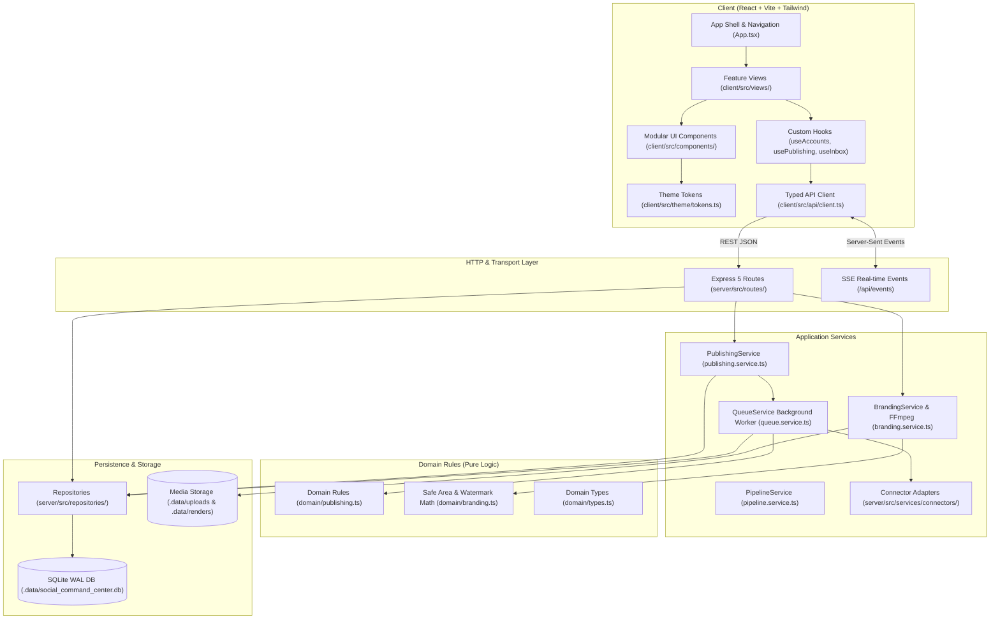
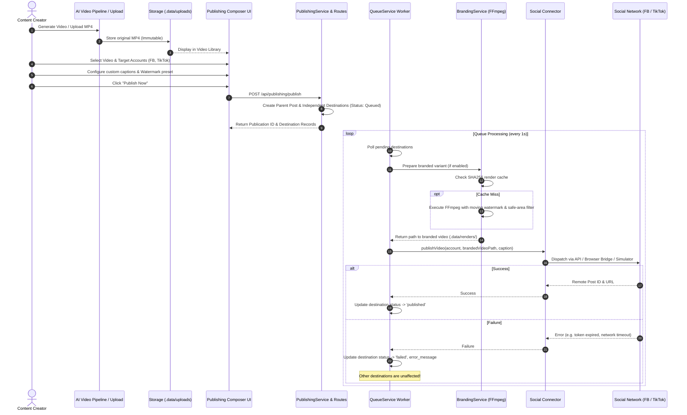

# Social Command Center — Project & Architecture Map

> **Comprehensive architectural reference, component map, and task-to-file navigation guide for the Social Command Center.**

---

## 1. High-Level System Architecture

---

## 2. Directory Layout & Layer Responsibilities

### Frontend (`client/src/`)
| Directory / File | Responsibility |
| :--- | :--- |
| [`client/src/App.tsx`](file:///d:/Mamduh/Personal/social-account-managemnet/client/src/App.tsx) | Navigation shell, active view switching, header, platform status strip. |
| [`client/src/theme/tokens.ts`](file:///d:/Mamduh/Personal/social-account-managemnet/client/src/theme/tokens.ts) | Semantic design tokens (surfaces, text colors, platform badges, safe area margins). |
| [`client/src/types/index.ts`](file:///d:/Mamduh/Personal/social-account-managemnet/client/src/types/index.ts) | Frontend TypeScript interface definitions matching backend contracts. |
| [`client/src/api/client.ts`](file:///d:/Mamduh/Personal/social-account-managemnet/client/src/api/client.ts) | Fully typed API client for accounts, publishing, branding, inbox, and analytics. |
| [`client/src/hooks/`](file:///d:/Mamduh/Personal/social-account-managemnet/client/src/hooks/) | State management hooks (`useAccounts.ts`, `usePublishing.ts`, `useInbox.ts`). |
| [`client/src/components/common/`](file:///d:/Mamduh/Personal/social-account-managemnet/client/src/components/common/) | Reusable presentation primitives: `Button`, `Badge`, `Card`, `Modal`, `MetricCard`, `EmptyState`. |
| [`client/src/components/accounts/`](file:///d:/Mamduh/Personal/social-account-managemnet/client/src/components/accounts/) | `AccountCard.tsx`, `CategoryCard.tsx`, `ConnectAccountModal.tsx`, `CreateCategoryModal.tsx`. |
| [`client/src/components/publishing/`](file:///d:/Mamduh/Personal/social-account-managemnet/client/src/components/publishing/) | `DestinationConfigCard.tsx`, `QueueTable.tsx`, `VideoLibraryGrid.tsx`. |
| [`client/src/components/branding/`](file:///d:/Mamduh/Personal/social-account-managemnet/client/src/components/branding/) | `WatermarkCanvas.tsx` (60 FPS HTML5 preview), `WatermarkControls.tsx`. |
| [`client/src/components/inbox/`](file:///d:/Mamduh/Personal/social-account-managemnet/client/src/components/inbox/) | `CommentItem.tsx`, `CommentFilters.tsx`. |
| [`client/src/views/`](file:///d:/Mamduh/Personal/social-account-managemnet/client/src/views/) | Composed view screens: `DashboardView`, `AccountsView`, `PublishingView`, `BrandingStudioView`, `InboxView`, `ActivityView`, `AnalyticsView`, `SettingsView`. |

### Backend (`server/src/`)
| Directory / File | Responsibility |
| :--- | :--- |
| [`server/src/index.ts`](file:///d:/Mamduh/Personal/social-account-managemnet/server/src/index.ts) | App initialization, database migration/bootstrapping, route mounting, background worker launch. |
| [`server/src/domain/`](file:///d:/Mamduh/Personal/social-account-managemnet/server/src/domain/) | Pure business rules and math: `publishing.ts`, `branding.ts`, `types.ts`. Free of I/O or DB. |
| [`server/src/repositories/`](file:///d:/Mamduh/Personal/social-account-managemnet/server/src/repositories/) | Data access layer using `better-sqlite3`: `accounts.repo.ts`, `publishing.repo.ts`, `inbox.repo.ts`, `activity.repo.ts`, `analytics.repo.ts`. |
| [`server/src/services/`](file:///d:/Mamduh/Personal/social-account-managemnet/server/src/services/) | Workflow orchestrators: `publishing.service.ts`, `queue.service.ts`, `branding.service.ts`, `pipeline.service.ts`. |
| [`server/src/services/connectors/`](file:///d:/Mamduh/Personal/social-account-managemnet/server/src/services/connectors/) | Platform adapters implementing `SocialConnector` interface: `simulator.connector.ts`, `meta.connector.ts`, `tiktok.connector.ts`, `browser-bridge.connector.ts`. |
| [`server/src/routes/`](file:///d:/Mamduh/Personal/social-account-managemnet/server/src/routes/) | Express 5 HTTP endpoints: `accounts.routes.ts`, `publishing.routes.ts`, `branding.routes.ts`, `inbox.routes.ts`, `activity.routes.ts`, `analytics.routes.ts`, `bridge.routes.ts`. |

---

## 3. Video-to-Publication Flow

---

## 4. Simulator vs. Live Verified Functionality

| Capability | High-Fidelity Simulator | Live Meta Graph API | Live TikTok Content API | Browser Bridge (Playwright) |
| :--- | :--- | :--- | :--- | :--- |
| **Video Publishing** | Simulated (Instant / Configurable delay) | Verified for Page Videos | Verified for TikTok Creator | Verified assisted upload |
| **Comment Ingestion** | Full simulated threads with realistic text | Verified via Page Webhooks / Graph | Requires TikTok Webhook Partner approval | Assisted scraping |
| **Comment Replies** | Simulated instant replies | Verified for Page comments | Restricted by TikTok (Platform Handoff) | Assisted automated reply |
| **Comment Reactions** | Simulated like/heart toggles | Verified for Facebook reactions | Restricted by TikTok | Assisted click |
| **Analytics & Retention**| Generated realistic curves | Verified via Page Insights | Creator Analytics API | Profile dashboard scrape |
| **Session Expiry** | Deterministic simulation (`status = 'expired'`) | OAuth Token expiration | Access token refresh flow | Cookie validation |

> [!IMPORTANT]
> The application honestly exposes these capabilities through `GET /api/connectors/capabilities`. The UI inspects these capabilities to render Native Platform Handoff buttons when direct API replies are restricted.

---

## 5. Task-to-File Reference Table

When working on a specific task, use this reference table to find the primary files, state contracts, and verification tests without having to search the entire project:

| Task | Primary Files | Related Contract / State | Relevant Tests |
| :--- | :--- | :--- | :--- |
| **Change Navigation or Top Header** | [`client/src/App.tsx`](file:///d:/Mamduh/Personal/social-account-managemnet/client/src/App.tsx) | `activeView`, `VIEW_KEYS` in [`client/src/types/index.ts`](file:///d:/Mamduh/Personal/social-account-managemnet/client/src/types/index.ts) | `test/e2e/autonomous_acceptance.ts` (Phase 1) |
| **Restyle Account Cards or Category Badges** | [`client/src/components/accounts/AccountCard.tsx`](file:///d:/Mamduh/Personal/social-account-managemnet/client/src/components/accounts/AccountCard.tsx) [`client/src/components/accounts/CategoryCard.tsx`](file:///d:/Mamduh/Personal/social-account-managemnet/client/src/components/accounts/CategoryCard.tsx) | `SocialAccount`, `ContentCategory` in [`client/src/types/index.ts`](file:///d:/Mamduh/Personal/social-account-managemnet/client/src/types/index.ts) | `test/e2e/autonomous_acceptance.ts` (Phase 3 Workflow A) |
| **Redesign Publishing Composer or Video Selector** | [`client/src/views/PublishingView.tsx`](file:///d:/Mamduh/Personal/social-account-managemnet/client/src/views/PublishingView.tsx) [`client/src/components/publishing/DestinationConfigCard.tsx`](file:///d:/Mamduh/Personal/social-account-managemnet/client/src/components/publishing/DestinationConfigCard.tsx) | `CreatePublishingPayload` in [`client/src/types/index.ts`](file:///d:/Mamduh/Personal/social-account-managemnet/client/src/types/index.ts) | `test/e2e/autonomous_acceptance.ts` (Phase 3 Workflow B) |
| **Modify Publishing Queue Table or Retry Actions** | [`client/src/components/publishing/QueueTable.tsx`](file:///d:/Mamduh/Personal/social-account-managemnet/client/src/components/publishing/QueueTable.tsx) [`client/src/hooks/usePublishing.ts`](file:///d:/Mamduh/Personal/social-account-managemnet/client/src/hooks/usePublishing.ts) | `PublishingDestination`, `DestinationStatus` | `test/social_command_center.test.ts` (Tests 3, 4, 5) |
| **Change Watermark Preview Canvas or Controls** | [`client/src/components/branding/WatermarkCanvas.tsx`](file:///d:/Mamduh/Personal/social-account-managemnet/client/src/components/branding/WatermarkCanvas.tsx) [`client/src/components/branding/WatermarkControls.tsx`](file:///d:/Mamduh/Personal/social-account-managemnet/client/src/components/branding/WatermarkControls.tsx) | `BrandingPreset`, `calculateWatermarkPosition` in [`server/src/domain/branding.ts`](file:///d:/Mamduh/Personal/social-account-managemnet/server/src/domain/branding.ts) | `test/domain_and_repositories.test.ts` (Tests 4, 5) |
| **Change Inbox Presentation or Reply Dialogs** | [`client/src/views/InboxView.tsx`](file:///d:/Mamduh/Personal/social-account-managemnet/client/src/views/InboxView.tsx) [`client/src/components/inbox/CommentItem.tsx`](file:///d:/Mamduh/Personal/social-account-managemnet/client/src/components/inbox/CommentItem.tsx) | `InboxComment` in [`client/src/types/index.ts`](file:///d:/Mamduh/Personal/social-account-managemnet/client/src/types/index.ts) | `test/e2e/autonomous_acceptance.ts` (Phase 3 Workflow D) |
| **Add a Connector Capability** | [`server/src/services/connectors/`](file:///d:/Mamduh/Personal/social-account-managemnet/server/src/services/connectors/) [`server/src/services/connectors/social-connector.interface.ts`](file:///d:/Mamduh/Personal/social-account-managemnet/server/src/services/connectors/social-connector.interface.ts) | `ConnectorCapabilities` interface | `test/social_command_center.test.ts` (Test 2) |
| **Modify Queue Dispatch or Recovery Logic** | [`server/src/services/queue.service.ts`](file:///d:/Mamduh/Personal/social-account-managemnet/server/src/services/queue.service.ts) [`server/src/domain/publishing.ts`](file:///d:/Mamduh/Personal/social-account-managemnet/server/src/domain/publishing.ts) | `PublishingRepo` in [`server/src/repositories/publishing.repo.ts`](file:///d:/Mamduh/Personal/social-account-managemnet/server/src/repositories/publishing.repo.ts) | `test/social_command_center.test.ts` (Test 9), `test/domain_and_repositories.test.ts` |
| **Change Ingestion Folder Configuration** | [`server/src/services/pipeline.service.ts`](file:///d:/Mamduh/Personal/social-account-managemnet/server/src/services/pipeline.service.ts) | `INGESTION_DIR` in `.env` / configuration | `test/e2e/autonomous_acceptance.ts` (Phase 1 Screen 8) |
| **Update Theme Colors, Surfaces, or Borders** | [`client/src/theme/tokens.ts`](file:///d:/Mamduh/Personal/social-account-managemnet/client/src/theme/tokens.ts) [`client/src/index.css`](file:///d:/Mamduh/Personal/social-account-managemnet/client/src/index.css) | `tokens` object (Surfaces, Text, Status, Safe Areas) | `npm run build:client` |
