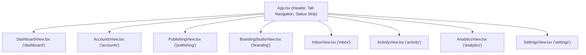

# Social Command Center — UI/UX Redesign Handoff Guide

> **Dedicated guide for the UI/UX design and frontend agent.**  
> Everything you need to redesign the interface into a warm, cozy, and approachable workspace without needing to inspect backend code or risk breaking core publishing features.

---

## 1. Product Purpose & Main User Workflows

The **Social Command Center** is a self-hosted desktop web hub for AI video creators who publish short-form and widescreen content across multiple branded social channels (Facebook Pages and TikTok creator accounts).

The creator’s day-to-day workflows consist of:
1. **Workspace Health & Connection Review** ([`AccountsView.tsx`](file:///d:/Mamduh/Personal/social-account-managemnet/client/src/views/AccountsView.tsx)):
   - Checking categorized channels (e.g., *Object to Life*, *Screen to Life*, *Cinematic AI*).
   - Seeing live status pills (Connected, Expired, Health Check) and triggering 1-click re-authorization.
2. **Video Publishing & Multi-Account Dispatch** ([`PublishingView.tsx`](file:///d:/Mamduh/Personal/social-account-managemnet/client/src/views/PublishingView.tsx)):
   - **Compose**: Ingesting/uploading an MP4, picking target Facebook and TikTok accounts, customizing per-platform captions, and queuing publication.
   - **Queue**: Monitoring real-time background queue progress with independent destination states and single-click "Retry Failed".
   - **Library**: Browsing AI-generated master videos from upstream production folders.
3. **Branding & Watermark Customization** ([`BrandingStudioView.tsx`](file:///d:/Mamduh/Personal/social-account-managemnet/client/src/views/BrandingStudioView.tsx)):
   - Adjusting digital watermark movement presets (`smooth_sine`, `corner_jump`, `diagonal_bounce`, `static_corner`), opacity, and scale.
   - Previewing real-time 60 FPS animation inside the TikTok 9:16 safe area overlay.
   - Test-rendering a master video with backend FFmpeg to verify export quality.
4. **Community Engagement Triage** ([`InboxView.tsx`](file:///d:/Mamduh/Personal/social-account-managemnet/client/src/views/InboxView.tsx)):
   - Reading unified incoming comments across networks.
   - Replying directly or clicking **Native Platform Handoff** when API policies require web moderation.
5. **Auditing & Analytics** ([`DashboardView.tsx`](file:///d:/Mamduh/Personal/social-account-managemnet/client/src/views/DashboardView.tsx), [`ActivityView.tsx`](file:///d:/Mamduh/Personal/social-account-managemnet/client/src/views/ActivityView.tsx), [`AnalyticsView.tsx`](file:///d:/Mamduh/Personal/social-account-managemnet/client/src/views/AnalyticsView.tsx)):
   - Reviewing genre retention curves and comparative engagement.

---

## 2. The Desired Visual Direction: "Cozy Creative Studio"

The next milestone is to transition the current dark, dense, utility-first console into a **warm, calm, approachable, and cozy creative workspace**:

### Core Aesthetic Pillars
- **Warm & Calm Surfaces**: Replace harsh slate/black `#0b0f17` surfaces with soft, soothing, tactile tones. Think warm oatmeal/parchment neutrals, warm sand, soft terracotta, matcha sage, or warm deep charcoal/espresso if dark mode is retained.
- **Approachable Typography & Spacing**: Generous line-heights, friendly humanist headers, relaxed card padding (`p-6` instead of cramped `p-3`), and gentle subtle borders instead of high-contrast borders.
- **Soft Tactile Micro-Interactions**: Rounded pill shapes (`rounded-2xl`, `rounded-full`), soft colored shadows, gentle springy hover transitions (`transition-all duration-200 ease-out`).
- **Cozy Emotional Metaphors**: Frame the interface not as an aggressive "server terminal / admin board", but as a comfortable "Creative Studio Desk" or "Creator Hearth".

> [!TIP]
> You do **not** need to touch the backend or database to achieve this. All visual styling is concentrated in the token layer ([`client/src/theme/tokens.ts`](file:///d:/Mamduh/Personal/social-account-managemnet/client/src/theme/tokens.ts)), Tailwind utility classes, and common presentation components.

---

## 3. Component & Route Inventory

### App Shell & Routing
The frontend is a lightweight Single-Page Application (SPA) driven by stateful tab switching in [`client/src/App.tsx`](file:///d:/Mamduh/Personal/social-account-managemnet/client/src/App.tsx):



### Extracted Component Directory
Every view has been refactored to consume clean, modular components:

```
client/src/
├── components/
│   ├── common/                       <-- SHARED PRESENTATION PRIMITIVES
│   │   ├── Badge.tsx                 <-- PlatformBadge, StatusBadge
│   │   ├── Button.tsx                <-- Primary, Secondary, Danger, Ghost variants + loading spinner
│   │   ├── Card.tsx                  <-- Cozy container with optional header & actions
│   │   ├── EmptyState.tsx            <-- Visual placeholder with icon and action button
│   │   ├── MetricCard.tsx            <-- Stat cards with trend chips and cozy accent bars
│   │   └── Modal.tsx                 <-- Accessible dialog with backdrop and Esc key support
│   │
│   ├── accounts/                     <-- ACCOUNTS & CHANNELS FEATURE
│   │   ├── AccountCard.tsx           <-- Channel card with avatar, category, health, and actions
│   │   ├── CategoryCard.tsx          <-- Production theme card with badge & account count
│   │   ├── ConnectAccountModal.tsx   <-- "Connect Account" dialog form
│   │   └── CreateCategoryModal.tsx   <-- "New Category" dialog form with color picker
│   │
│   ├── publishing/                   <-- MULTI-DESTINATION PUBLISHING FEATURE
│   │   ├── DestinationConfigCard.tsx <-- Account selector checkbox + per-platform caption textarea
│   │   ├── QueueTable.tsx            <-- Queue item table with independent retry actions
│   │   └── VideoLibraryGrid.tsx      <-- Master video browser cards with thumbnail & metadata
│   │
│   ├── branding/                     <-- BRANDING & WATERMARK STUDIO
│   │   ├── WatermarkCanvas.tsx       <-- 60 FPS HTML5 canvas with safe-area overlays & preset animation
│   │   └── WatermarkControls.tsx     <-- Sliders, movement presets, color pickers, test render button
│   │
│   └── inbox/                        <-- ENGAGEMENT INBOX FEATURE
│       ├── CommentFilters.tsx        <-- Category, platform, and sentiment filter chips
│       └── CommentItem.tsx           <-- Threaded comment card, sentiment badge, reply action
```

### Custom Stateful Hooks
The views do not perform raw HTTP queries. State is managed through dedicated hooks:
- [`client/src/hooks/useAccounts.ts`](file:///d:/Mamduh/Personal/social-account-managemnet/client/src/hooks/useAccounts.ts): Fetches accounts and categories, handles account connection, category creation, token health check, and re-authentication.
- [`client/src/hooks/usePublishing.ts`](file:///d:/Mamduh/Personal/social-account-managemnet/client/src/hooks/usePublishing.ts): Loads videos and publication queue, handles master video upload, dispatch, retry failed, cancellation, and manual confirmation.
- [`client/src/hooks/useInbox.ts`](file:///d:/Mamduh/Personal/social-account-managemnet/client/src/hooks/useInbox.ts): Loads comments, manages filter state, handles replies and like/heart toggles.

---

## 4. Stable Behavioral Contracts (DO NOT BREAK)

Automated end-to-end acceptance tests run against the live DOM using Playwright. **You can completely change CSS styling, colors, layout, and iconography**, but you must preserve the following text labels and interaction semantics:

### A. Navigation & Tab Buttons
The top navigation buttons must contain these exact text labels (case-insensitive substring match):
- `"Dashboard"`
- `"Accounts & Categories"`
- `"Publishing"`
- `"Branding Studio"`
- `"Engagement Inbox"`
- `"Activity"`
- `"Analytics"`
- `"Settings & Bridge"`

### B. Action Buttons & Modals
- **Accounts**:
  - Button text: `"Connect Account"` (opens account modal)
  - Button text: `"New Category"` (opens category modal)
  - Button text: `"Reconnect"` (initiates simulated re-auth)
  - Button text: `"Check Health"` (pings connector status)
  - Modal buttons: `"Cancel"`, `"Save Category"`
- **Publishing**:
  - Tab buttons: `"Compose Post"`, `"Publish Queue"`, `"Video Library"`
  - Button text: `"Publish Now"` (dispatches publication)
  - Button text: `"Retry Destination"` (retries a failed destination)
  - Button text: `"Cancel"`
- **Branding**:
  - Button text: `"Render Preview"` or `"Render Branded Video"`
  - Preset options: `"smooth_sine"`, `"corner_jump"`, `"diagonal_bounce"`, `"static_corner"`
- **Inbox**:
  - Filter buttons: `"All"`, `"Facebook"`, `"TikTok"`
  - Button text: `"Reply"`
- **Settings**:
  - Button text: `"Scan Directory Now"`

---

## 5. Design Tokens & Styling Architecture

All tokens are centralized in [`client/src/theme/tokens.ts`](file:///d:/Mamduh/Personal/social-account-managemnet/client/src/theme/tokens.ts):

```typescript
export const tokens = {
  surfaces: {
    app: 'bg-[#0f172a] text-slate-100', // Change to cozy studio background
    card: 'bg-slate-800/60 border border-slate-700/60 rounded-xl',
    cardHover: 'hover:border-slate-600 transition-colors',
    input: 'bg-slate-900 border border-slate-700 rounded-lg text-slate-100',
    header: 'bg-slate-900/80 backdrop-blur-md border-b border-slate-800',
  },
  platforms: {
    facebook: { bg: 'bg-blue-900/30', text: 'text-blue-400', border: 'border-blue-700/50' },
    tiktok: { bg: 'bg-pink-900/30', text: 'text-pink-400', border: 'border-pink-700/50' },
  },
  status: {
    published: { badge: 'bg-emerald-900/40 text-emerald-300 border border-emerald-700/50' },
    failed: { badge: 'bg-rose-900/40 text-rose-300 border border-rose-700/50' },
    queued: { badge: 'bg-amber-900/40 text-amber-300 border border-amber-700/50' },
    processing: { badge: 'bg-indigo-900/40 text-indigo-300 border border-indigo-700/50' },
  },
  safeArea: {
    tiktok916: {
      top: 120,    // Top header & search area overlay
      bottom: 280, // Sound title, description, music disc overlay
      right: 120,  // Profile avatar, like, comment, share icons
      left: 30,    // Left margin
    }
  }
};
```

To introduce your cozy palette:
1. Update `tokens.surfaces` in `tokens.ts`.
2. Update button styles in [`client/src/components/common/Button.tsx`](file:///d:/Mamduh/Personal/social-account-managemnet/client/src/components/common/Button.tsx).
3. Update cards in [`client/src/components/common/Card.tsx`](file:///d:/Mamduh/Personal/social-account-managemnet/client/src/components/common/Card.tsx).
4. Run `npm run build:client` to compile and verify.

---

## 6. Safe-Area Coordinates & Watermark Animation Rules

The Branding Studio features an interactive HTML5 preview canvas ([`client/src/components/branding/WatermarkCanvas.tsx`](file:///d:/Mamduh/Personal/social-account-managemnet/client/src/components/branding/WatermarkCanvas.tsx)) and a backend FFmpeg generator ([`server/src/domain/branding.ts`](file:///d:/Mamduh/Personal/social-account-managemnet/server/src/domain/branding.ts)).

### TikTok 9:16 Video Canvas Rules
The normalized coordinate space is standard vertical HD: $720 \times 1280$ (or $1080 \times 1920$):
- **Safe Bounds**:
  - Minimum $X$: $30\text{px}$
  - Maximum $X$: $\text{Video Width} - \text{Watermark Width} - 120\text{px}$ (prevents overlap with like/share buttons)
  - Minimum $Y$: $120\text{px}$ (prevents overlap with account handle/search bar)
  - Maximum $Y$: $\text{Video Height} - \text{Watermark Height} - 280\text{px}$ (prevents overlap with captions and music disk)

### Movement Presets
- `smooth_sine`: Watermark oscillates smoothly across the horizontal axis using $\sin(2\pi \cdot t / \text{cycle})$.
- `corner_jump`: Watermark transitions cleanly between safe quadrant corners every $N$ seconds.
- `diagonal_bounce`: Watermark bounces diagonally with reflection when touching safe boundaries.
- `static_corner`: Watermark remains anchored at a designated safe corner with user-selected opacity.

> [!NOTE]
> The Canvas preview and FFmpeg command builder use the identical mathematical domain formulas located in [`server/src/domain/branding.ts`](file:///d:/Mamduh/Personal/social-account-managemnet/server/src/domain/branding.ts). If you redesign the canvas UI, keep `WatermarkCanvas.tsx`'s internal coordinate loop intact.

---

## 7. Recommended Read-First Order for the Redesign Agent

1. **Step 1 — Understand Tokens & App Shell**:
   - Open [`client/src/theme/tokens.ts`](file:///d:/Mamduh/Personal/social-account-managemnet/client/src/theme/tokens.ts) and [`client/src/App.tsx`](file:///d:/Mamduh/Personal/social-account-managemnet/client/src/App.tsx).
   - Review current dark tokens and plan your cozy palette tokens.
2. **Step 2 — Restyle the Common Primitives**:
   - Open [`client/src/components/common/Card.tsx`](file:///d:/Mamduh/Personal/social-account-managemnet/client/src/components/common/Card.tsx), [`Button.tsx`](file:///d:/Mamduh/Personal/social-account-managemnet/client/src/components/common/Button.tsx), [`Badge.tsx`](file:///d:/Mamduh/Personal/social-account-managemnet/client/src/components/common/Badge.tsx), [`MetricCard.tsx`](file:///d:/Mamduh/Personal/social-account-managemnet/client/src/components/common/MetricCard.tsx), [`Modal.tsx`](file:///d:/Mamduh/Personal/social-account-managemnet/client/src/components/common/Modal.tsx).
   - Apply warm card backgrounds, soft shadows, rounded borders, and inviting button states.
3. **Step 3 — Restyle Views Step-by-Step**:
   - **Start with Dashboard**: [`client/src/views/DashboardView.tsx`](file:///d:/Mamduh/Personal/social-account-managemnet/client/src/views/DashboardView.tsx).
   - **Then Channels & Categories**: [`client/src/views/AccountsView.tsx`](file:///d:/Mamduh/Personal/social-account-managemnet/client/src/views/AccountsView.tsx).
   - **Then Publishing Center**: [`client/src/views/PublishingView.tsx`](file:///d:/Mamduh/Personal/social-account-managemnet/client/src/views/PublishingView.tsx).
   - **Then Branding Studio**: [`client/src/views/BrandingStudioView.tsx`](file:///d:/Mamduh/Personal/social-account-managemnet/client/src/views/BrandingStudioView.tsx).
   - **Then Engagement Inbox**: [`client/src/views/InboxView.tsx`](file:///d:/Mamduh/Personal/social-account-managemnet/client/src/views/InboxView.tsx).
4. **Step 4 — Verify Changes Frequently**:
   ```powershell
   # 1. Check TypeScript & Vite compile
   npm run build:client

   # 2. Run E2E Playwright acceptance test to guarantee 0 regressions
   npx tsx test/e2e/autonomous_acceptance.ts
   ```
