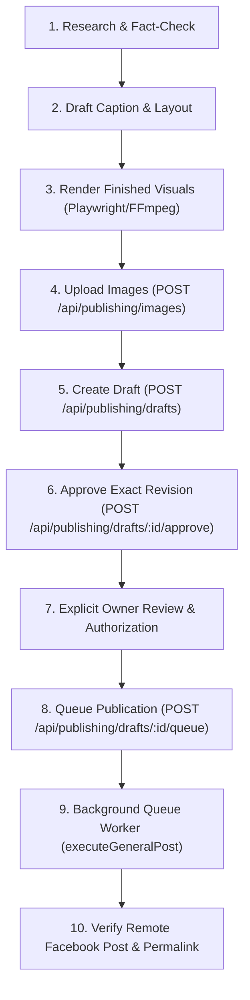

# Creative Playbook: Facebook Page "แก้บัคยาวๆๆ" (Page A)

> **Document Type:** Canonical Operational Creative Playbook  
> **Target Account:** Facebook Page **แก้บัคยาวๆๆ**  
> **Internal Account ID:** `acc-f50fc6bc-b89b-4f4f-99ff-9f3c4fcbfac5`  
> **Verified Graph Page ID:** `409347032254077`  
> **First Successful Real Publication:** `409347032254077_122196999368464828` (27 October 2026, 14:14 Bangkok)  
> **Authority & Governance:** Mandatory permanent guide for all current and future AI agent sessions.

---

## 1. Page Identity, Mission & Audience

### 1.1 Core Mission
**แก้บัคยาวๆๆ** is a self-hosted Thai technology content brand dedicated to solving everyday digital headaches, explaining software quirks, exploring emerging tools, and sharing practical tricks for modern phone, computer, and internet users.

### 1.2 Target Audience
* **Everyday Users & Office Professionals:** People who use LINE, Facebook, Windows, macOS, iPhone, and Android daily for work and communication, constantly encountering frustrating technical limitations (e.g., blurry videos, storage bloat, file transfers).
* **Tech Enthusiasts & Curious Digital Citizens:** Users who want to understand "why things work the way they do" without drowning in academic jargon.
* **Junior Developers & Content Creators:** Individuals creating media or writing code who appreciate honest, practical tips from someone in the trenches.

> **CRITICAL RULE:** Do NOT turn this Page into an internal engineering status feed, QA release log, or test announcement board. Audience assumptions are hypotheses until validated by real post performance analytics.

---

## 2. Creative Research Workflow

Before writing any draft, follow this structured research process:

1. **Identify a Genuine Human Pain Point:**
   - Look for real everyday friction (e.g., LINE video compression, battery drain myths, cloud storage traps, Wi-Fi stutter, file format confusion).
   - Ask: *"Would a stranger scrolling through Facebook find this genuinely useful, funny, or eye-opening?"*
2. **Benchmark Top Thai Tech Creators:**
   - Consult `docs/content/CREATIVE_BENCHMARKS_PAGE_A.md` for proven storytelling mechanisms from creators like **9arm** (whiteboard analogies, demystifying global tech drama), **BorntoDev** (barrier-to-entry empathy, hands-on tool evaluation), and **Extreme IT** (consumer hardware mythbusting).
   - Use actual public source URLs and examine *why* their framing engages viewers.
   - Learn structure and pacing without plagiarizing topics or text.
3. **Verify Against Primary Documentation:**
   - Check official documentation (e.g., LINE Help Center, Apple Developer Docs, Meta Graph Docs, Android Developer Guides).
   - Distinguish demonstrated system behavior from internet folklore or secondary forum rumors.

---

## 3. Writing Style & Editorial Guidelines

### 3.1 Voice & Tone
* **Natural Everyday Thai:** Write like a knowledgeable, helpful tech peer explaining something over coffee.
* **Familiar English Tech Terms:** Blend natural Thai syntax with standard industry English terms (e.g., *Video Transcode, Binary Data, Save to Files, Bitrate, Resolution, Cloud Storage, Bug, Crash*).
* **Informal, Accessible Vocabulary:** Use `คนอื่น` instead of formal `ผู้อื่น`, `ในเครื่อง` instead of `ภายในอุปกรณ์`, `แชท` instead of `การสนทนาข้อความ`.
* **Light Humor & Relatability:** Use understated, relatable humor where appropriate without turning into slapstick.

### 3.2 What to Avoid (Strict Prohibitions)
* **NO Decorative Emojis:** Do not sprinkle emojis (😭, ❌, 💡, 🍎, 👉, ⚠️, 💾, 🐛, 🚀) as decoration. Clean typography and bullets are more professional and readable.
* **NO Excessive Hashtags:** Keep hashtags strictly to 2–3 relevant tags (e.g., `#แก้บัคยาวๆๆ #LINE #VideoQuality`). Never dump walls of 10+ tags.
* **NO Exaggerated Promises or Marketing Drama:** Never claim *"รับประกัน 100%"*, *"ดีที่สุดในโลก"*, *"ภาพแตกเป็นวุ้นเละเทะ"*, or make extreme claims that cannot be proven.
* **NO Forced Engagement Bait:** Do not write mechanical engagement requests like *"กดเซฟเลย"*, *"กดไลก์กดแชร์ถ้าชอบ"*, or *"คอมเมนต์ด้านล่างเลยครับ"*. Quality content earns saves organically.
* **NO Formal Textbook / Academic Thai:** Avoid passive voice and archaic grammar structures (*"ได้รับการระบุว่า"*, *"อนึ่ง"*).
* **NO Invented Personal Experiences:** Do not fabricate anecdotal stories (*"เมื่อวานผมเพิ่งเจอกับตัว..."*) unless reporting actual verified test evidence.

---

## 4. Visual Quality Standards

### 4.1 Layout, Aspect Ratio & Typography
* **Canvas Format:** Standard **1080 × 1350 px (4:5 vertical)** for Facebook mobile feed dominance.
* **Visual Theme:** Deep dark sleek slate (`#0B0F17` / `#111827`) with brand accent lighting (LINE green `#00E676`, Cyan `#38BDF8`, Warning `#FBBF24`, Danger `#FF5252`).
* **Typography:** Modern Thai web typography (`Kanit` for punchy bold headlines, `Prompt` for comfortable body copy, `Inter` / monospace for technical specs).
* **Contrast & Hierarchy:** High contrast text on dark glassmorphic cards (`rgba(30, 41, 59, 0.65)` with subtle borders).

### 4.2 Honesty in Visual Assets
* **Mandatory Simulation Disclaimers:** Whenever an image illustrates a degradation or comparison without a live byte-for-byte platform capture, it **MUST** include an explicit disclaimer:  
  `* ภาพจำลองเพื่ออธิบายผลของการลดทอนคุณภาพ ไม่ใช่ผลทดสอบโดยตรงจากระบบ...`
* **Real Context Over Generic Stock:** Do not use random irrelevant photos (e.g., street food night markets to illustrate video compression). Use relevant contextual visuals (e.g., creator studio frame, realistic device UI mockups).
* **Mobile Comfort:** Never cram 5-column desktop tables into mobile slides. Use clean stacked cards (3-tier layouts) with generous padding and readable font sizes.

---

## 5. Factual Verification Rules

Before calling any draft publication-ready:
1. **Never Invent Universal Numbers:** Do not claim *"4K will always become 720p"* or *"Quality is degraded by 85–90%"* unless quoting an official protocol specification. Algorithms vary by device, connection, and version.
2. **Never Invent Fixed Policies:** If an app does not publicly state an expiration duration (e.g., LINE server retention), state clearly: *"LINE does not specify an exact duration, but chat files are stored temporarily"*.
3. **Never State Platform Limits as Universal Rules:** Differentiate between client-side UX friction (e.g., iOS Document Picker not reading Photos) vs actual server limits.
4. **Distinguish Local Simulation from Real Testing:** If a live transmission test was not executed on real accounts, state so plainly in the evidence report. A beautiful slide containing unverified numbers is rejected content.

---

## 6. Social Command Center Publishing Workflow

All creative posts for Page A must be produced and published strictly through the application's supported API workflow. **NEVER attempt manual database injection or bypass the publishing engine.**



### Supported API Endpoints
* **Image Upload:** `POST /api/publishing/images` (Multipart form-data with `image` file) $\rightarrow$ Returns verified `mediaId`, `sha256`, dimensions.
* **Draft Creation:** `POST /api/publishing/drafts` (JSON payload with `title`, `contentType: 'multi_image'`, `destinations: [{ accountId, caption, hashtags, attachments }]`).
* **Draft Approval:** `POST /api/publishing/drafts/:id/approve` (JSON `{ revision: number }`).
* **Queue Dispatch:** `POST /api/publishing/drafts/:id/queue` (JSON `{ revision: number }`).
* **Queue Verification:** `GET /api/publishing/posts` $\rightarrow$ inspects post status, destination status, `remote_post_id`, and `remote_post_url`.
* **Reconciliation (if network uncertain):** `POST /api/publishing/destinations/:id/reconcile` (read-only verification of existing remote ID without duplicate submission).

---

## 7. Canonical Reference Example (Gold Standard)

The first owner-approved and live-published multi-image post serves as the permanent reference benchmark:

### Approved Post Metadata
* **Parent Post ID:** `post-094048b5-999b-4005-af4a-1bf4e816f694`
* **Destination ID:** `dest-ba63baca-0c40-4a42-8808-9446f6ee8d4f`
* **Remote Facebook Post ID:** `409347032254077_122196999368464828`
* **Live Facebook Permalink:** [https://www.facebook.com/122196967700464828/posts/122196999368464828](https://www.facebook.com/122196967700464828/posts/122196999368464828)
* **Published Timestamp:** `2026-10-27T07:14:26.000Z` (14:14 Bangkok)
* **Confirmation Source:** `api` (Official Meta Graph API v26.0)

### Approved Visual Assets
1. **Slide 1:** `01_line_video_quality_gemini.png`  
   - Heading: *"ส่งคลิปใน LINE ทำไมภาพไม่คมชัดเท่าต้นฉบับ?"*  
   - Dimensions: 1080 × 1350 px | Size: 795,575 bytes  
   - SHA-256: `8649351391fd15b8c47907b9914fe1e4967c3db14fdaabb2a85e3d532db7847c`
2. **Slide 2:** `02_line_send_file_guide_gemini.png`  
   - Heading: *"วิธีส่งคลิปเลี่ยงการบีบอัด ส่งผ่านเมนู File"*  
   - Dimensions: 1080 × 1350 px | Size: 464,092 bytes  
   - SHA-256: `fc8092f5da4da0e02abc7d949aafe550ca7a6198bccd4cdea3d619a86396893b`
3. **Slide 3:** `03_line_pro_matrix_gemini.png`  
   - Heading: *"เปรียบเทียบวิธีส่งคลิป และข้อจำกัดที่ควรรู้"*  
   - Dimensions: 1080 × 1350 px | Size: 538,934 bytes  
   - SHA-256: `66e2a03230e529007a4d1e759cbb2485d99be2c461f82a70e0e9d89100a0aa6c`

### Approved Caption
```text
ทำไมส่งวิดีโอใน LINE แล้วภาพไม่ชัดเหมือนต้นฉบับ?

เวลาเราส่งคลิปผ่านปุ่มรูป/วิดีโอปกติ LINE จะส่งไฟล์เข้าสู่กระบวนการ Video Transcode เพื่อบีบอัดขนาดไฟล์และ Bitrate ให้สามารถเปิดเล่นในห้องแชทได้ทันที

ส่วนเมนูตั้งค่า "คุณภาพรูปที่ส่ง" (Sent photo quality) ใน LINE Settings จะมีผลเฉพาะกับภาพนิ่งเท่านั้น ไม่มีผลกับวิดีโอ

ถ้าต้องการส่งคลิปงานที่อยากรักษาคุณภาพไฟล์ต้นฉบับ ลองเปลี่ยนมาส่งผ่านเมนู File แทน:
- Android และ LINE บนคอมพิวเตอร์: กดปุ่ม + แล้วเลือก File หรือลากไฟล์คลิปมาวางในห้องแชท
- iOS (iPhone/iPad): วิดีโอในแอป Photos จะไม่แสดงในเมนู File โดยตรง ให้เปิดคลิปใน Photos > กด Share > เลือก "Save to Files" ก่อน แล้วจึงเข้า LINE กด + > File เพื่อเลือกคลิปที่เซฟไว้

ข้อควรทราบ:
1. ไฟล์ที่ส่งในห้องแชทจะถูกเก็บไว้บนเซิร์ฟเวอร์เพียงชั่วคราว (LINE ไม่ได้ระบุระยะเวลาที่แน่นอน) ผู้รับควรดาวน์โหลดเก็บไว้ในเครื่องทันที
2. หากเป็นคลิปขนาดใหญ่หรือต้องการส่งงานอย่างเป็นทางการ การแชร์ผ่าน Cloud Storage (เช่น Google Drive หรือ OneDrive) ยังคงเป็นวิธีที่แน่นอนที่สุด

#แก้บัคยาวๆๆ #LINE #VideoQuality
```

---

## 8. Rejected Antipatterns (Lessons Learned)

Future agents must study why previous iterations were rejected:
* **Antipattern 1: Internal Changelogs & Test Logs**  
  * *Rejected:* Posting about QA testing, migration checkpoints, or internal database sync.  
  * *Reason:* Completely uninteresting to outside social media followers.
* **Antipattern 2: Fabricated Universal Statistics**  
  * *Rejected:* Stating that *"LINE always squashes 4K to 720p and loses 85–90% of quality"*.  
  * *Reason:* Unsupported by official specs; variations exist across devices and networks.
* **Antipattern 3: Unlabeled Visual Simulations**  
  * *Rejected:* Showing artificial pixelation without stating it was an illustrative simulation.  
  * *Reason:* Dishonest presentation that risks damaging creator authority.
* **Antipattern 4: Emoji Walls & Clickbait Marketing**  
  * *Rejected:* Adding 15+ emojis, exclamation marks, and asking users to save and share.  
  * *Reason:* Degrades brand credibility into cheap spam.
* **Antipattern 5: Cramped Mobile Tables**  
  * *Rejected:* 5-column comparison matrices with tiny font sizes.  
  * *Reason:* Completely illegible on mobile screens.

---

## 9. Continuous Improvement & Operational Limits

1. **Track Real Performance:** Monitor impressions, reach, reactions, shares, and comments using Social Command Center's automatic synchronization. Never fabricate engagement metrics.
2. **Iterative Refinement:** Update this playbook only after observing consistent performance across multiple real posts.
3. **Strict Authorization Boundary:** Today's publication authorization was for **ONE** post only. Any future publication requires **explicit, separate owner authorization**.
