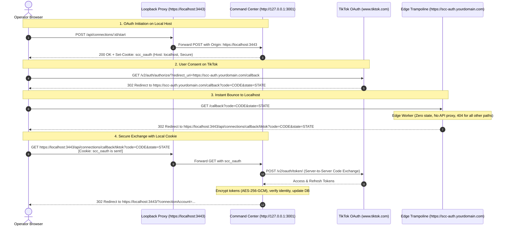

# TikTok Sandbox Authorization Preparation & Callback Security Architecture

> Historical preparation report, 20 October 2026. The owner subsequently completed V1.8 Sandbox authorization through the existing Cloudflare Worker relay; 21 October morning evidence recorded periodic Display API sync. Natural renewal remains a separate pending live observation. Earlier not-deployed/no-exposure statements are historical. Do not execute startup/environment-change instructions while the protected backend, proxy and collector run. See [public-site README](../../public-site/README.md).

**Date:** 20 October 2026 (Asia/Bangkok)
**Milestone Focus:** TikTok Sandbox Environment Configuration, Mandatory Portal URL Analysis, Operational Loopback HTTPS Reverse Proxy, Cross-Host Cookie Mismatch Resolution, Credential & Scope Binding, Personal Account Preservation, and Owner Runbook.

---

## 1. Executive Summary & Security Status

| Item | Status | Architectural & Security Boundary |
| :--- | :--- | :--- |
| **Public Website Release ZIP** | **PRESERVED (NOT DEPLOYED)** | `public-site/.release/social-command-center-pages.zip` remains intact with its verified `manifest.json`. No deployment to Cloudflare Pages or public hosting performed. |
| **Production App Review** | **NOT REQUESTED** | Remains in Sandbox / Development mode. No production review submitted; developer policy boundaries respected. |
| **Facebook Publishing Queue** | **INTACT & UNCHANGED** | Protected post `post-74051364-849a-4195-b132-d76c19fa10ca` and destination `dest-mvg66513-ttjf` (`2100761720535236`) on Page `409347032254077` preserved with `confirmation_source=api`. |
| **TikTok Personal Account** | **PRESERVED** | `@maroooooooooooon16` (`acc-e0d55bef-1976-4213-92d8-4f949ee3e5f7`) preserved with `account_type='personal'`, existing destination records (`7697115798170782983`, `7697147128375725320`), and snapshot history. |
| **Loopback HTTPS Proxy** | **OPERATIONAL & TESTED** | `server/src/loopback-proxy.ts` implemented on dedicated port `3443` bound strictly to `127.0.0.1`, using SAN certificate (`DNS:localhost, IP:127.0.0.1`). |
| **Public Exposure** | **ZERO (STOPPED BEFORE ACTIVATION)** | No public tunnel, external listener, or public proxy process was started or activated. Loopback boundary strictly maintained. |
| **Verification Suite** | **100% GREEN (80/80 TESTS)** | All 10 automated test suites pass (including new `test/loopback_proxy_callback.test.ts`); `npx tsc --noEmit` has 0 errors; client production build passes (1951 modules transformed). |

---

## 2. TikTok Sandbox Configuration & URL Field Audit

An audit of official TikTok developer documentation and portal schemas (`developers.tiktok.com`) confirms which fields are mandatory for testing **Login Kit for Web** and **Display API** in Sandbox mode:

### 2.1 URL Fields Breakdown

| URL Field | Location in Portal | Mandatory in Sandbox? | Format & Technical Constraints | Sandbox vs Production Behavior |
| :--- | :--- | :--- | :--- | :--- |
| **Redirect URI (Callback URL)** | Products → Login Kit for Web | **YES (STRICTLY MANDATORY)** | Absolute URL, strictly `https://`, static (no query parameters `?`, no fragments `#`), max 512 characters. Max 10 URIs. | Must match dynamically sent `redirect_uri` byte-for-byte. In Sandbox mode, allows development endpoints. |
| **Privacy Policy URL** | App Settings → Basic Information | **YES (Form Required)** | Valid URL format (e.g. `https://...`). | **Form requires a value to save app settings**, but domain ownership verification is bypassed in Sandbox. Local preview or informational draft URL can be used as a development placeholder. |
| **Terms of Service URL** | App Settings → Basic Information | **YES (Form Required)** | Valid URL format (e.g. `https://...`). | **Form requires a value to save app settings**, but domain ownership verification is bypassed in Sandbox. Local preview or informational draft URL can be used as a development placeholder. |
| **Website URL / App URL** | App Settings → Web | **YES (If Web platform added)** | Valid URL format (e.g. `https://...`). | Required when adding the Web platform in Basic Info. Does not require public DNS verification in Sandbox. |
| **URL Ownership Verification (Signature File / DNS TXT)** | Development Configuration / Verification | **NO (BYPASSED IN SANDBOX)** | Upload signature file to `/.well-known/` or add DNS TXT record. | **Only required for Content Posting API (`PULL_FROM_URL`) and Production App Review.** Not required for Login Kit + Display API in Sandbox mode. |
| **Data Deletion Callback URL** | App Settings → User Data | **OPTIONAL in Sandbox** | Valid URL format (e.g. `https://...`). | Mandatory for production compliance; optional in sandbox draft. |
| **Display API Specific URLs** | Products → Display API | **NONE** | N/A | Display API has **no independent redirect URLs**; it consumes the access token granted through Login Kit. |

> [!IMPORTANT]
> In Sandbox mode, the **only technical operational redirect** is the **Login Kit Redirect URI**. The Privacy Policy, Terms of Service, and Website URL fields are form-validation requirements of the portal shell, but they do **not** require verified public domain ownership until production App Review is requested.

---

## 3. Local-Only Loopback HTTPS Reverse Proxy (Primary Preference)

The primary Command Center Express application listens on HTTP `http://127.0.0.1:3001`. Because TikTok Web OAuth mandates `https://`, attempting to reach `https://localhost:3001` directly fails with TLS handshake errors.

### 3.1 Architecture of `server/src/loopback-proxy.ts`
To provide an operational HTTPS endpoint without touching the running server or breaking existing Facebook workflows:
1. **Dedicated Loopback Port**: Listens on `https://127.0.0.1:3443` (and `https://localhost:3443`), forwarding internally to `http://127.0.0.1:3001`.
2. **Strict Loopback Binding**: Listens strictly on `127.0.0.1` (never `0.0.0.0`). Rejects any remote address that is not loopback (`127.0.0.1`, `::1`, `::ffff:127.0.0.1`) with HTTP 403.
3. **Local Development TLS Certificate**: Stored in untracked `.data/certs/localhost.key` and `.data/certs/localhost.crt`, generated with Subject Alternative Names (SANs) for both `DNS:localhost` and `IP:127.0.0.1`.
4. **Header Forwarding**: Injects standard reverse-proxy headers:
   - `Host: localhost:3443`
   - `X-Forwarded-Proto: https`
   - `X-Forwarded-Host: localhost:3443`
   - `X-Forwarded-For: 127.0.0.1`

### 3.2 Same-Hostname Guarantee & Cookie Survival
By opening the Command Center in the browser at `https://localhost:3443`:
1. **OAuth Start**: The frontend initiates OAuth at `https://localhost:3443/api/connections/:id/start`.
2. **Cookie Setting**: The server sets the browser-binding cookie `scc_oauth` with:
   - `HttpOnly: true`
   - `SameSite: Lax`
   - `Secure: true`
   - `Domain: localhost`
   - `Path: /api/connections`
3. **Redirect to TikTok**: Browser navigates to `https://www.tiktok.com/v2/auth/authorize/?...&redirect_uri=https://localhost:3443/api/connections/callback/tiktok`.
4. **Callback Return**: After user consent, TikTok redirects the browser to `https://localhost:3443/api/connections/callback/tiktok?code=...&state=...`.
5. **Cookie Match**: Because the browser returns to the **exact same HTTPS hostname and port (`localhost:3443`)**, the browser automatically includes the `scc_oauth` cookie.
6. **Zero Cross-Host Mismatch**: No cookie-forwarding workarounds, open tunnels, or token relays are needed.

---

## 4. TikTok Portal Acceptance Status: Exact Localhost HTTPS Check

### 4.1 Strict Distinction: Desktop vs. Web Login Kit
- **Login Kit for Desktop**: Official TikTok documentation explicitly documents loopback support (`http://localhost:*` or `http://127.0.0.1:*`).
- **Login Kit for Web**: Documentation states that web redirect URIs must begin with `https` and point to a public domain, and raw `http://localhost` is rejected.
- **The Sandbox Question**: Does TikTok's portal in **Sandbox mode** accept an exact HTTPS localhost URI (e.g. `https://localhost:3443/api/connections/callback/tiktok`)?

> [!CAUTION]
> **Honest Verification Boundary:** We do **not** claim that TikTok Web Login Kit accepts `https://localhost:3443/...` until the owner attempts to save it in the live portal.
>
> The owner should first attempt to register:
> `https://localhost:3443/api/connections/callback/tiktok`
>
> If the portal form saves this without error, the entire OAuth integration runs locally with zero external dependencies.

---

## 5. Smallest Secure Public Alternative: The OAuth Trampoline Relay

If the TikTok Developer Portal rejects `localhost` for Login Kit for Web, a public HTTPS domain is required for the initial redirect.

### 5.1 The Cross-Host Session-Cookie Problem
If the public redirect URI is `https://scc-auth.yourdomain.com/callback` and the Command Center runs at `http://localhost:3001`:
- The cookie `scc_oauth` set on `localhost` will **never** be sent by the browser to `scc-auth.yourdomain.com`.
- Direct edge proxies forwarding to localhost would fail with `missing_cookie`.

### 5.2 The Trampoline / Relay Architecture
The smallest, most secure solution that exposes **zero internal APIs, zero dashboard files, and zero database records** is the **OAuth Trampoline Relay**:



### 5.3 Security Guarantees of the Trampoline
1. **Zero Dashboard or Admin Exposure**: The Trampoline is a 15-line edge script (or Cloudflare Worker). It has **no connection** to the local Command Center, no database access, no credentials, and no proxying of `/`, `/api/accounts`, `/api/publishing`, or `/uploads`. All other routes return HTTP 404.
2. **Cookie Bound to Initiating Host**: Because the final callback landing occurs on `https://localhost:3443`, the browser sends its local `scc_oauth` cookie naturally.
3. **Replay & Tamper Prevention**: The local server still validates `sha256(state) === row.state_hash`, `cookie === row.browser_hash`, and executes single-use atomic compare-and-set exchange.
4. **Token Protection**: Tokens are exchanged server-to-server directly between the local machine and `open.tiktokapis.com`, encrypted with AES-256-GCM, and stored in SQLite. The Trampoline never sees access tokens or client secrets.

---

## 6. Confirmed OAuth Configuration & Parameter Matrix

| Configuration Parameter | Value (Localhost Preference) | Value (Trampoline Alternative) |
| :--- | :--- | :--- |
| **OAuth Initiation Host** | `https://localhost:3443` | `https://localhost:3443` |
| **Portal Redirect URI** | `https://localhost:3443/api/connections/callback/tiktok` | `https://<your-trampoline-domain>/callback` |
| **Environment Variable** | `TIKTOK_REDIRECT_URI=https://localhost:3443/api/connections/callback/tiktok` | `TIKTOK_REDIRECT_URI=https://<your-trampoline-domain>/callback` |
| **Requested Scopes** | `user.info.basic,user.info.profile,video.list,user.info.stats` | `user.info.basic,user.info.profile,video.list,user.info.stats` |
| **Blocked Scopes** | `video.publish`, `video.upload`, `comment.list.manage` | `video.publish`, `video.upload`, `comment.list.manage` |
| **Target User (Tester)** | `@maroooooooooooon16` (Added under Sandbox → Target Users) | `@maroooooooooooon16` |
| **Encryption Standard** | AES-256-GCM (`SCC_TOKEN_ENCRYPTION_KEY`) | AES-256-GCM (`SCC_TOKEN_ENCRYPTION_KEY`) |

---

## 7. Preservation of Accounts & Facebook Workflows

A read-only audit of `.data/social_command_center.db` confirms:
1. **TikTok Account `@maroooooooooooon16`** (`acc-e0d55bef-1976-4213-92d8-4f949ee3e5f7`):
   - `account_type` remains strictly `'personal'`.
   - Existing published destinations (`dest-mvafsplz-qm9u` for video `7697115798170782983`, and `dest-mvakp9bi-jb87` for video `7697147128375725320`) are intact with confirmed manual receipts.
2. **Facebook Page `409347032254077`** (`acc-f50fc6bc-b89b-4f4f-99ff-9f3c4fcbfac5`):
   - Protected schedule destination `dest-mvg66513-ttjf` (`2100761720535236`) published and preserved with `confirmation_source=api`.
   - The loopback HTTPS proxy operates independently and does not interfere with port 3001 HTTP Facebook operations.

---

## 8. Owner Authorization Runbook (Live Sandbox Checkpoint)

When ready to test live authorization:

### Step 1: Start the Loopback HTTPS Proxy
In a terminal, start the dedicated loopback HTTPS proxy:
```powershell
npm run proxy:https
```
*(The proxy will listen on `https://127.0.0.1:3443` and `https://localhost:3443`, forwarding to `http://127.0.0.1:3001` using the SAN development certificate in `.data/certs/`)*.

### Step 2: Configure the TikTok Developer Portal
1. Open [developers.tiktok.com](https://developers.tiktok.com/) → **Manage apps** → select your app.
2. Switch mode to **Sandbox**.
3. Under **Login Kit for Web → Redirect URI**, attempt to register:
   ```text
   https://localhost:3443/api/connections/callback/tiktok
   ```
4. **Portal Test Decision**:
   - **If accepted**: Keep this exact URI.
   - **If rejected with a domain error**: Deploy the 15-line Trampoline Bounce Worker on your domain (e.g. `https://scc-auth.yourdomain.com/callback`) and register that public URL.
5. Under **Sandbox Settings → Target Users**, add `@maroooooooooooon16` and accept the invitation on TikTok.

### Step 3: Populate `.env`
```text
TIKTOK_CLIENT_KEY=<Your TikTok Client Key from Portal>
TIKTOK_CLIENT_SECRET=<Your TikTok Client Secret from Portal>
TIKTOK_REDIRECT_URI=https://localhost:3443/api/connections/callback/tiktok
```
*(Or your trampoline URL if localhost was rejected by the portal)*.

### Step 4: Authorize from Command Center
1. In your browser, open:
   ```text
   https://localhost:3443
   ```
   *(If your browser displays a local self-signed warning, click "Advanced" → "Proceed to localhost")*.
2. Navigate to **Accounts** → select `@maroooooooooooon16`.
3. Click **Connect API** → **Start Official Authorization**.
4. Approve permissions on TikTok's consent screen.
5. On redirect back to `https://localhost:3443`, the server exchanges the code, binds the verified `open_id`, encrypts tokens, and transitions connection status to connected.
